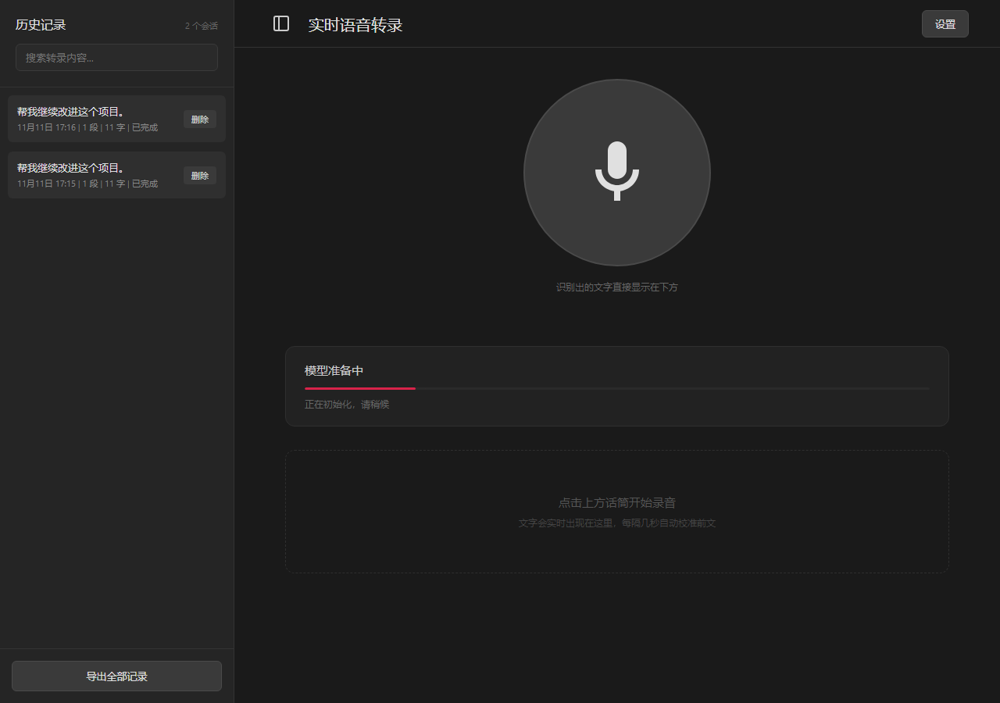

# 实时语音转录

本地运行的语音转文字工具。Qwen3-ASR-0.6B 在本机 GPU 推理，提供网页实时转录、双击 Ctrl 全局语音输入、局域网 API 三种用法。



## 功能

1. 网页实时转录：说完停顿约 0.6 秒即出字，滑动窗口自动校正前文，输出统一简体。
2. 全局语音输入：任意窗口双击 Ctrl 说话，松手后自动注入焦点输入框，支持浏览器、微信、Word、终端与命令行工具。
3. 局域网 API：启动即监听独立端口，同网段的 Mac、手机、脚本可直接调用，与网页共用同一份模型。
4. 历史管理：会话留存、内容搜索、一键导出、合并音频回放。
5. 单人使用定位：推理串行排队，多人并发时的行为与容量见 [docs/API.md](docs/API.md)。

## 快速开始

1. 环境要求：Windows 10 及以上，Python 3.11，NVIDIA 显卡，显存 4GB 以上。

2. 创建虚拟环境并安装依赖：

```bash
python -m venv venv
venv\Scripts\activate
pip install torch==2.11.0 --index-url https://download.pytorch.org/whl/cu128
pip install -r requirements.txt -i https://pypi.tuna.tsinghua.edu.cn/simple
```

3. 下载模型权重，国内用 ModelScope 最快：

```bash
pip install modelscope
modelscope download --model Qwen/Qwen3-ASR-0.6B --local_dir ./models/Qwen3-ASR-0.6B
```

权重放到 `models/Qwen3-ASR-0.6B/` 后自动使用本地路径，启动时不再联网。目录不存在会回落到 HuggingFace 自动下载。

4. 以管理员身份双击 `just_run.bat`。全局热键需要管理员权限。

启动后服务默认在 `http://127.0.0.1:6100`，端口被占用时会自动顺延并打印真实端口。

## 使用

### 网页转录

打开 `http://127.0.0.1:6100`，点话筒或按空格开始。首次启动会在后台加载模型，界面显示加载进度，约 8 秒后可录音。

### 桌面语音输入

在任意窗口双击 Ctrl 开始说话，再双击一次、按 Esc、或说完静音约 1 秒自动结束。识别结果直接输入到当前焦点位置。终端内自动回车，适合 `opencode` 这类命令行工具。

### 局域网 API

启动时自动在独立线程监听 `0.0.0.0:6101`，终端会打印访问地址与密钥：

```
  局域网 API 已就绪，同网段的 Mac / 手机可直接调用：
    地址: http://192.168.0.107:6101/api/v1
    密钥: xxxxxxxxxxxxxxxxxxxxxxxx
    请求头: X-API-Key
```

```bash
curl -X POST http://你的内网IP:6101/api/v1/transcribe \
  -H "X-API-Key: 你的密钥" \
  -F "audio=@录音.wav" -F "language=zh"
```

完整接口、错误码与调用示例见 [docs/API.md](docs/API.md)。

## 配置

常用环境变量，写在系统环境或 `.env`：

| 变量 | 默认 | 说明 |
|---|---|---|
| `ASR_SERVER_PORT` | 6100 | 网页服务端口 |
| `ASR_LAN_API` | 1 | 设为 0 关闭局域网 API 线程 |
| `ASR_LAN_PORT` | 6101 | 局域网 API 端口 |
| `ASR_API_KEY` | 自动生成 | 固定 API 密钥，留空则生成并保存到 `src/recordings/.lan_api_key` |
| `ASR_AUDIT` | 0 | 设为 1 时后台用 LLM 对照识别结果，只写审计日志，不改显示文本 |
| `ASR_PRELOAD` | 1 | 设为 0 跳过模型预热，测试时用 |

桌面代理参数在 `src/desktop_agent.py` 顶部：

| 参数 | 默认 | 说明 |
|---|---|---|
| `SILENCE_AUTO_STOP` | 1.0 秒 | 静音多久自动结束 |
| `DOUBLE_TAP_INTERVAL` | 0.42 秒 | 两次 Ctrl 的最大间隔 |
| `AUTO_ENTER_IN_TERMINAL` | True | 终端内注入后自动回车 |
| `TYPEWRITE_ASCII` | True | 纯英文走逐字敲击，不碰剪贴板 |

LLM 凭证可选，默认不参与出字。需要审计时在 `.env` 配置 `OPENROUTER_API_KEY` 和 `NVIDIA_API_KEY`。

## 性能

RTX 3060 实测：4.2 秒音频识别约 0.7 至 1.1 秒，停止收尾 8 至 18 毫秒，桌面代理松手到注入约 1.7 至 2.1 秒。

## 项目结构

```
just_run.bat          启动入口
run_all.py            进程管理与端口探测
src/app.py            网页服务入口
src/lan_server.py     局域网 API 线程
src/services.py       模型加载与推理
src/desktop_agent.py  全局语音输入代理
src/routes/           网页、会话、记录、API 路由
src/templates/        单文件前端
src/recordings/       录音、转录、数据库，已忽略入库
models/               本地模型权重，已忽略入库
tests/                测试
docs/                 接口文档
```

## 测试

```bash
python tests/test_desktop_agent.py
python tests/test_inject.py
python tests/test_ui_contract.py
python tests/test_ui_static.py
python tests/test_api.py
python tests/test_path_traversal.py
python tests/test_session_guard.py
```

## 已知限制

1. 全局热键依赖 `keyboard` 库，部分安全软件或高权限进程可能拦截。
2. 局域网 API 没有 TLS，只适合可信内网。
3. 推理串行，多人同时请求会排队，详见 [docs/API.md](docs/API.md)。
